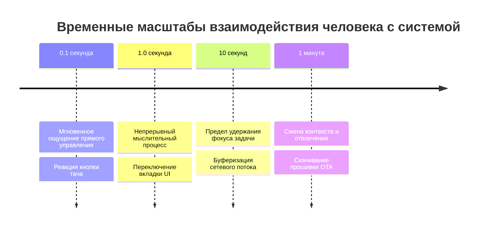

# Время отклика: 3 важнейших предела юзабилити
## Jakob Nielsen (Якоб Нильсен), Nielsen Norman Group (NN/g)
### Аналитический обзор принципов проектирования интерактивных систем (1993 – 2026)

---

## 1. Введение: Почему время реакции имеет фундаментальное значение?
Якоб Нильсен, признанный пионер юзабилити и сооснователь Nielsen Norman Group, сформулировал базовые правила взаимодействия человека с вычислительными устройствами в книге *«Usability Engineering» (1993)* и серии исследований *«Powers of 10: Time Scales in User Experience»*.

Нильсен подчеркивает: **Ограничения времени отклика продиктованы не технологиями, а биологией человеческого мозга.** Физиология восприятия, архитектура зрительного анализатора и емкость кратковременной памяти человека неизменны уже десятки тысяч лет.

---

## 2. Три ключевых временных предела (The 3 Important Limits)

### Предел 1: 0.1 секунды (100 миллисекунд) — Иллюзия непосредственного управления
* **Биологическое обоснование:** Сенсорный регистр зрения и моторная кора обрабатывают входящий сигнал за время порядка 50–100 мс.
* **Пользовательский опыт:** Если система реагирует в пределах 100 мс, человеку кажется, что **он сам совершил действие над физическим объектом**. Вектор манипуляции непрерывен: палец нажал — экран сразу изменился.
* **Требование к коду:** При тапе по сенсорному экрану ESP32 кнопка **обязана визуально измениться за 100 мс**.
* **Последствия нарушения:** Если отклик занимает 300–500 мс, возникает ощущение «ватного» управления или проскальзывания. При задержке > 1 секунды пользователь уверен, что нажатие не зарегистрировано.

### Предел 2: 1.0 секунда — Сохранение непрерывности мышления
* **Биологическое обоснование:** Кратковременная рабочая память человека хранит текущую мысль и цель без подкрепления в течение примерно 1 секунды.
* **Пользовательский опыт:** Пользователь замечает небольшую паузу, но сохраняет фокус на задаче. Его мыслительный поток не разрывается, он не отводит взгляд от экрана.
* **Требование к коду:** Если сетевая операция (например, переключение интернет-радиостанции) занимает **более 1 секунды**, интерфейс категорически не имеет права оставаться статичным. Обязателен статус:
  - Изменение надписи на *«Подключение...»*;
  - Анимация загрузки или спиннер;
  - Звуковой сигнал подтверждения.

### Предел 3: 10 секунд — Предел удержания внимания
* **Биологическое обоснование:** Через 10 секунд рабочая память очищается от контекста текущей подзадачи. Наступает психологическая разгрузка.
* **Пользовательский опыт:** Пользователь прекращает ждать, начинает смотреть по сторонам, проверять телефон или испытывает желание перезагрузить устройство по питанию.
* **Требование к коду:** Если сетевой поток не отвечает за 10–15 секунд, система обязана прекратить попытки (таймаут) и четко сообщить: *«Ошибка связи с сервером. Повторить?»*, вернув интерфейс в отзывчивое состояние.

---

## 3. Масштабы времени по Нильсену (Powers of 10)

Нильсен рассматривает время в UX через логарифмическую шкалу степеней десятки:

---

## 4. Паттерны обратной связи (Feedback Patterns)

Нильсен делит обратную связь в интерфейсе на два обязательных типа:

### 1. Пассивная обратная связь (Passive Feedback — до 100 мс)
* Мгновенная инверсия цвета кнопки.
* Прорисовка рамки фокуса.
* Изменение значка или заголовка на экране.
* **Правило:** Никаких расчетов и сетевых обращений до завершения отрисовки пассивной связи!

### 2. Активная обратная связь (Active Feedback — при задержках > 1 с)
* Информационное сообщение о текущем этапе: *«DNS...»* $\to$ *«Подключение...»* $\to$ *«Буферизация...»* $\to$ *«Играет»*.
* Прогресс-бар заполнения кольцевого буфера.
* Наличие доступной кнопки «Отмена» / «Стоп».

---

## 5. Главный вывод для разработчиков микроконтроллеров и HMI
> *«Никогда не заставляйте пользователя гадать, жив ли прибор. Если прибор молчит дольше 100 миллисекунд после прикосновения — для человека этот прибор завис.»* — Якоб Нильсен.
