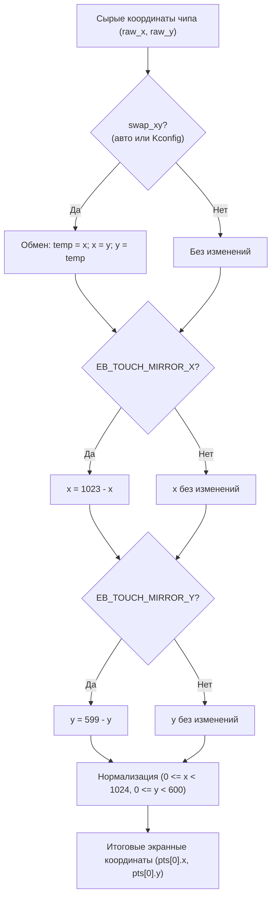

# Архитектура и работа сенсорного экрана (Touch) в CamBrowser

Данный документ подробно описывает, как устроен и работает сенсорный ввод на плате **GUITION JC1060P470C_I_W_Y** (ESP32-P4 + дисплей JD9165 1024×600 MIPI-DSI).

---

## 1. Аппаратное подключение (Hardware Wiring)

На плате JC1060P470C установлен емкостный тач-контроллер **Goodix GT911** (также поддерживается автоопределение контроллеров FT5x06 и CST816).

Тач-контроллер подключен к микроконтроллеру ESP32-P4 по шине **I2C**:

| Сигнал | GPIO ESP32-P4 | Назначение |
|---|---|---|
| **SCL** | **GPIO8** | Тактовая линия I2C (аппаратный порт I2C 1, 400 кГц) |
| **SDA** | **GPIO7** | Линия данных I2C (аппаратный порт I2C 1) |
| **RST** | **GPIO5** | Аппаратный сброс тач-контроллера (Active Low) |
| **INT** | *-1* (плавающий) / GPIO9 | Прерывание и выбор адреса I2C при сбросе |

> [!IMPORTANT]
> **Шина I2C разделяется с аудиокодеком ES8311**:
> Тач-контроллер GT911 и аудиокодек ES8311 физически находятся на одной и той же шине I2C (GPIO8/GPIO7). Драйвер `camos/touch.c` первым инициализирует шину I2C Master, а драйвер аудио `media/media_audio.c` повторно использует этот дескриптор шины через функцию `touch_get_i2c_bus()`.

---

## 2. Инициализация и выбор I2C-адреса (Hardware Reset Sequence)

У контроллера **GT911** адрес на шине I2C не фиксирован жестко: он фиксируется аппаратно в момент снятия сигнала сброса **RST** в зависимости от состояния вывода **INT**:
- Если в момент отпускания `RST` вывод `INT` имеет низкий уровень (0) → адрес **`0x5D`**.
- Если высокий уровень (1) → адрес **`0x14`**.

### Процедура сброса в коде (`touch_hw_reset()`):
1. Пин `RST` (GPIO5) переводится в режим выхода.
2. Если `INT` подключен, он принудительно прижимается к 0.
3. Линия `RST` переводится в 0 (сброс) на 10 мс.
4. Линия `RST` переводится в 1 (снятие сброса).
5. Пауза **60 мс**: контроллеру GT911 необходимо не менее 50 мс для загрузки внутренней прошивки до готовности отвечать по шине I2C.

---

## 3. Автоопределение контроллера (Probing)

Функция `touch_init()` выполняет сканирование шины:
1. Пробует подключиться к устройствам из списка кандидатов:
   - `0x5D` (GT911)
   - `0x14` (GT911)
   - `0x38` (FT5x06)
   - `0x15` (CST816)
2. Для GT911 считываются 4 байта из 16-битного регистра идентификатора продукта **`0x8140`**:
   - Чип отвечает строкой `"911\0"` (или `"9271"`, `"928\0"` для других чипов семейства GT9xx).
3. Если устройство ответило, считывается заголовок конфигурации GT911 (регистры `0x8047`..`0x804E`):
   - Версия конфигурации чипа (`cfg[0]`).
   - Заводской диапазон вывода по осям: `Xout` (`cfg[1..2]`) и `Yout` (`cfg[3..4]`).
   - Автоматически проверяется ориентация: если у чипа `Xout < Yout` (портретная), а у дисплея 1024×600 (альбомная), флаг `swap_xy` автоматически включается для выравнивания осей.

---

## 4. Протокол чтения координат GT911

Опрос сенсора происходит периодически в цикле задачи браузера (`browser_task` с задержкой 30 мс, ~33 Гц) через функцию `touch_poll()`.

В GT911 используется 16-битная адресация регистров (Big-Endian: сначала старший байт адреса):

```
       I2C Read
[ESP32] ───────▶ Чтение регистра статуса 0x814E (1 байт)
                  ├── bit 7: флаг готовности буфера (buffer ready)
                  └── bits 0..3: количество активных касаний (0..5)
```

1. **Проверка статуса (`0x814E`)**:
   - Если старший бит 7 не установлен (`status & 0x80 == 0`), новых данных нет — функция немедленно завершает опрос.
2. **Чтение данных точек (`0x814F`)**:
   - Данные точек начинаются строго с регистра **`0x814F`**.
   - На каждую точку приходится 8 байт:
     ```c
     struct gt911_point {
         uint8_t track_id;     // 0x814F + 8*i: ID трека касания
         uint8_t x_lo;         // 0x8150 + 8*i: младший байт X
         uint8_t x_hi;         // 0x8151 + 8*i: старший байт X
         uint8_t y_lo;         // 0x8152 + 8*i: младший байт Y
         uint8_t y_hi;         // 0x8153 + 8*i: старший байт Y
         uint8_t size_lo;      // 0x8154 + 8*i: размер пятна касания
         uint8_t size_hi;      // 0x8155 + 8*i
         uint8_t reserved;     // 0x8156 + 8*i
     };
     ```
   - Сырые координаты: `raw_x = x_lo | (x_hi << 8)`, `raw_y = y_lo | (y_hi << 8)`.
3. **Квитирование буфера**:
   - После чтения контроллер требует сбросить регистр статуса, иначе он перестанет генерировать новые координаты.
   - ESP32 отправляет 3 байта: `[0x81, 0x4E, 0x00]`.

---

## 5. Преобразование координат в экранные

Сырые координаты чипа преобразуются в систему координат экрана **1024×600** в следующем порядке:



Настройки трансформации в `menuconfig`:
- `CONFIG_EB_TOUCH_SWAP_XY`: поменять местами оси X и Y.
- `CONFIG_EB_TOUCH_MIRROR_X`: зеркалирование по горизонтали.
- `CONFIG_EB_TOUCH_MIRROR_Y`: зеркалирование по вертикали.

---

## 6. Обработка нажатий в интерфейсе (`browser.c`)

В основном цикле `browser_task`:
```c
int n = touch_poll(pts, TOUCH_MAX_POINTS);
bool touch_now = (n > 0);
int tap_x = (n > 0) ? pts[0].x : 0;
int tap_y = (n > 0) ? pts[0].y : 0;

// Детекция клика по переднему фронту (нажатие пальцем):
bool tap = touch_now && !prev_touch;
```

Координаты `tap_x, tap_y` передаются в функции проверки попадания:
- `keyboard_hit(tap_x, tap_y)` — проверка попадания по клавишам виртуальной клавиатуры.
- `urlrow_go_hit(tap_x, tap_y)` — нажатие на строку поиска или кнопку GO.
- `home_apps_hit(tap_x, tap_y, &id)` — выбор иконок приложений («ФИЛЬМЫ», «ВИДЕО», «РАДИО», «WI-FI»).
- `nav_hit(tap_x, tap_y, &nav_id)` — кнопки навигации («НАЗАД», «ДОМОЙ», стрелки скролла «▲ / ▼»).

---

## 7. Диагностика тача по крайним точкам (Extreme Points Tracking)

Для калибровки и проверки ориентации сенсора в модуль `camos/touch.c` встроена система диагностики крайних точек:
- Ведется учет минимальных и максимальных сырых координат (`raw_min_x..raw_max_x`, `raw_min_y..raw_max_y`).
- Отслеживаются экранные координаты.
- При обновлении крайних значений в серийный порт выдается лог диапазона.
- При касании одного из 4-х углов экрана (зона 90×90 px) выдается специальное уведомление `[TOUCH CORNER]`.

### Как проверить правильность калибровки:
Запустите `idf.py monitor` и поочередно коснитесь пальцем 4 углов экрана:
1. **Левый верхний угол (Top-Left)**: должно быть `screen ≈ (0, 0)`, лог `[TOUCH CORNER] TOP-LEFT`.
2. **Правый верхний угол (Top-Right)**: должно быть `screen ≈ (1023, 0)`, лог `[TOUCH CORNER] TOP-RIGHT`.
3. **Левый нижний угол (Bottom-Left)**: должно быть `screen ≈ (0, 599)`, лог `[TOUCH CORNER] BOTTOM-LEFT`.
4. **Правый нижний угол (Bottom-Right)**: должно быть `screen ≈ (1023, 599)`, лог `[TOUCH CORNER] BOTTOM-RIGHT`.

Если при нажатии на правый верхний угол определяется левый нижний — требуется включить зеркалирование (`MIRROR_X` / `MIRROR_Y`) или переставить оси (`SWAP_XY`) через `idf.py menuconfig`.

---

## 8. Визуальный экран калибровки и тестирования (Touch Test / Calibration Mode)

В дополнение к выводу в UART-монитор, в прошивку встроен полноценный интерактивный визуальный экран тестирования и калибровки прямо на 7-дюймовом дисплее 1024×600.

### Как открыть:
На главном экране (HOME) нажмите плитку **«ТАЧ ТЕСТ»** рядом с кнопкой «Wi-Fi».

### Что отображается на экране:
1. **Координатная сетка**:
   - Шаг 128 px по горизонтали и 100 px по вертикали, яркие центральные оси `(512, 300)`.
2. **4 угловые мишени калибровки (Corner Targets 120×120 px)**:
   - **TL** `(0, 0)`, **TR** `(1024, 0)`, **BL** `(0, 600)`, **BR** `(1024, 600)`.
   - **Интерактивная подсветка**:
     - При касании угла прямо сейчас — плитка вспыхивает ярким акцентным цветом с надписью `НАЖАТ!`.
     - После проверки угол сохраняет статус подтверждения: подсвечивается зеленой рамкой и галочкой `OK!`.
3. **Полноэкранное перекрестие и бейдж координат**:
   - При касании через точку пальца проводятся линии `X` и `Y` во весь дисплей.
   - В центре рисуются концентрические круги прицела.
   - Рядом с пальцем всплывает плавающий бейдж с точными координатами:
     - `X: %d  Y: %d` (экранные пиксели)
     - `sensor raw: (%d, %d)` (сырые координаты с чипа сенсора).
4. **Непрерывный след касания (Touch Trail)**:
   - При перемещении пальца рисуется плавная линия траектории, позволяющая оценить линейность, отсутствие задержек и разрывов по всей диагонали матрицы.
5. **Мультитач**:
   - При касании несколькими пальцами (до 5 точек) дополнительные точки подсвечиваются отдельными мишенями с номерами `#2`, `#3` и собственными координатами.
6. **Верхняя управляющая HUD-панель**:
   - Показывает модель чипа (`GT911`), текущее состояние, накопленные экстремумы `Min..Max`.
   - Индикаторы 4 углов: `[TL] [TR] [BL] [BR]` и статус `ВСЕ 4 УГЛА OK!`.
   - Кнопка **«СБРОС»**: очистка следа, экстремумов и подтверждений углов.
   - Кнопка **«ВЫХОД»**: мгновенный возврат в главное меню браузера.

