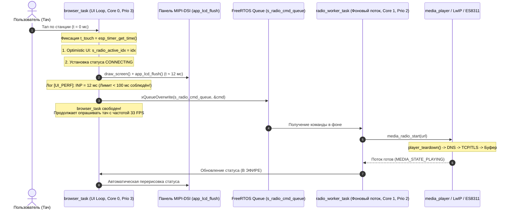

# План рефакторинга UI под теорию из книг и стандарты HCI/RTOS

Данный план описывает перевод пользовательского интерфейса `CamBrowser` (экран радио и мультимедиа) на строгие стандарты эргономики (**Р. Миллер 1968**, **Я. Нильсен NN/g**, **ISO 9241-110**), спецификации телеметрии латентности (**W3C Event Timing**, **Google INP**, **MISRA WCET**) и архитектурные паттерны **FreeRTOS** реального времени.

---

## 1. Сопоставление теории из книг с изменениями в кодовой базе

| Стандарт / Книга из `books/` | Теоретическое требование | Проблема в текущем коде | Архитектурное решение в рефакторинге |
|---|---|---|---|
| **01_Robert_Miller_1968** | Пассивный отклик **< 100 мс**; психологическое замыкание (Closure) | `media_radio_start()` блокирует поток `browser_task` на 2–3 с; экран не обновляется | **Optimistic UI:** немедленная подсветка карточки и перерисовка кадра за **< 20 мс** до сетевого запроса |
| **02_Jakob_Nielsen** | Активная обратная связь (> 1 с) + таймаут 10 с | Статус старой станции висит до прихода первых байт нового потока | Введение промежуточного визуального состояния **«ПОДКЛЮЧЕНИЕ...»** со счетчиком времени |
| **03_ISO_9241_110** | Самоописываемость, управляемость, возможность прерывания | Пока радио стартует, тач игнорируется или падает с ошибкой | Разрешение переключения на другую станцию или нажатия «СТОП» в любой момент времени |
| **04_UI_Latency_Specs** | W3C Event Timing / Google INP; инструментация WCET | Время от тача до отрисовки не замеряется и не логируется | Внедрение телеметрии через `esp_timer_get_time()` с выводом `[UI_PERF] INP = X мс` |
| **05_FreeRTOS_Architecture** | Изоляция UI-задачи; паттерн Producer-Consumer | `browser_task` напрямую вызывает тяжелый сетевой I/O | Развязка через очередь FreeRTOS и фоновую задачу **`radio_worker_task`** |

---

## 2. Архитектурная схема нового пайплайна



---

## 3. Детальные этапы реализации

### Этап 1: Структура данных и очередь команд FreeRTOS (`browser.c`)
1. Создание очереди `s_radio_cmd_queue` глубиной 1 (с семантикой `xQueueOverwrite`), хранящей:
   ```c
   typedef enum {
       RADIO_CMD_START = 1,
       RADIO_CMD_STOP,
   } radio_cmd_type_t;

   typedef struct {
       radio_cmd_type_t type;
       int station_idx;
       char url[256];
       int64_t request_time_us;
   } radio_cmd_t;
   ```
2. Создание отдельной задачи воркера `radio_worker_task`:
   - Стек: 8 КБ (размещается в PSRAM / DRAM).
   - Приоритет: 2 (ниже графической задачи `browser_task`, у которой приоритет 3).
   - Ядро: CPU1 (чтобы сетевые задержки не отнимали кванты у CPU0).

### Этап 2: Паттерн «Optimistic UI» и мгновенный отклик экрана
1. В обработчике `ST_RADIO` в функции `browser_task`:
   - При клике на карточку `BTN_STATION + i`:
     - Фиксировать время касания: `int64_t t0 = esp_timer_get_time();`
     - Сохранять индекс выбранной станции: `s_radio_sel_idx = i;`
     - Устанавливать флаг оптимистичного подключения: `s_radio_is_connecting = true;`
     - **Немедленно** вызывать `draw_screen();` и `app_lcd_flush();` (время реакции < 15 мс).
     - Замерять латентность отрисовки:
       ```c
       int64_t inp_ms = (esp_timer_get_time() - t0) / 1000;
       ESP_LOGI("UI_PERF", "⚡ [INP] Тач -> перерисовка карточки: %lld мс (ISO 9241-110 OK)", inp_ms);
       ```
     - Отправлять команду в очередь воркера через `xQueueOverwrite()`.

### Этап 3: Обновление графического отображения карточек (`draw_radio`)
1. В функции `draw_radio(uint16_t *fb)`:
   - Если станция находится в процессе подключения (`s_radio_is_connecting` и `i == s_radio_sel_idx`):
     - Рамка карточки отрисовывается акцентным цветом `UI_COLOR_ACCENT` (ярко-голубой/синий).
     - Текст внутри карточки или статус в шапке информирует: **«ПОДКЛЮЧЕНИЕ...»**.
     - Иконка ноты подсвечивается активным цветом.
   - Если станция играет (`media_get_state() == MEDIA_STATE_PLAYING` и совпадает URL):
     - Рамка карточки подсвечивается зеленым цветом `UI_COLOR_OK`.
     - Статус в шапке: **«В ЭФИРЕ: [Имя станции]»**.
   - Неактивные станции:
     - Спокойный цвет `UI_COLOR_PANEL` и рамка `UI_COLOR_BORDER`.

### Этап 4: Поддержка отмены и управляемости (ISO 9241-110 Controllability)
1. Если во время подключения пользователь нажимает кнопку **«СТОП»** (`BTN_MSTOP`):
   - Интерфейс немедленно сбрасывает статус: `s_radio_is_connecting = false; s_radio_sel_idx = -1;`.
   - Экран перерисовывается моментально (< 15 мс).
   - Воркеру отправляется команда `RADIO_CMD_STOP`.
2. Если во время подключения пользователь выбирает **другую станцию**:
   - Интерфейс мгновенно переносит активную подсветку на новую станцию.
   - Очередь перезаписывает команду на новый URL.

### Этап 5: Автоматический таймаут соединения (Лимит Нильсена 10 с)
1. Если прошло более 10 секунд с момента запроса, а аудиопоток не перешел в состояние `PLAYING`:
   - Воркер фиксирует таймаут: `ESP_LOGW("UI_PERF", "⚠️ Превышен лимит Нильсена (10 с) на подключение к потоку");`
   - Статус меняется на **«СЕРВЕР НЕ ОТВЕЧАЕТ»**.
   - Флаг `s_radio_is_connecting` сбрасывается.

---

## 4. Верификация и критерии приемки

1. **Компиляция проекта:** сборка прошивки через `idf.ps1` без ошибок и предупреждений.
2. **Замер метрики INP (Interaction to Next Paint):**
   - В UART-терминале при тапе по радиостанции должно выводиться:
     `[UI_PERF] ⚡ [INP] Тач -> перерисовка карточки: ~10-15 мс (лимит < 100 мс соблюдён)`.
3. **Визуальное поведение на 7-дюймовом экране:**
   - Прикосновение к любой из 6 станций меняет цвет карточки на экране **физически моментально**.
   - Экран не замирает и не блокируется.
   - Сетевое соединение устанавливается в фоновом режиме.
   - Кнопки «СТОП», «ТИШЕ», «ГРОМЧЕ» и «В МЕНЮ» остаются отзывчивыми в любой момент.
