# 📊 Инфографический отчет: Модульное тестирование CamBrowser (ESP32-P4)

> **Статус тестового набора:** `100% УСПЕШНО` (19 из 19 тестов пройдены)  
> **Время выполнения:** `0.0019 с`  
> **Целевая платформа:** GUITION JC1060P470C (ESP32-P4, 1024×600 MIPI-DSI, ES8311, SDMMC)  
> **Скрипт запуска:** `.\run_tests.ps1`

---

## 🚀 1. Ключевые показатели (KPI Dashboard)

| Метрика | Значение | Статус | Комментарий |
| :--- | :---: | :---: | :--- |
| **Всего Unit-тестов** | **19** | `100%` | Охвачены все 4 ключевых программных модуля |
| **Успешно пройденных** | **19** | `PASS` | Ни одного падения или регрессии |
| **Проваленных тестов** | **0** | `ZERO` | Ошибки отсутствуют |
| **Скорость выполнения** | **1.9 мс** | `INSTANT` | Мгновенный прогон без необходимости прошивки платы |
| **Критические подсистемы** | **4 / 4** | `COVERED` | HTML/SERP, MP4/H.264, Touch/Calib, Icecast Radio |

---

## 🗺️ 2. Архитектура протестированных подсистем

```mermaid
graph TD
    subgraph UI_And_Input ["Ввод и Отображение"]
        A[Тачскрин JC1060P470C] -->|Сырые точки raw X,Y| B(Модуль калибровки touch_calib)
        B -->|Экранные координаты 1024x600| C{Хит-тест кнопок и UI}
    end

    subgraph Web_Search ["Поиск и Веб-парсинг"]
        D[DuckDuckGo / Google SERP] -->|HTML разметка| E(Парсер html_text)
        E -->|Удаление скриптов/стилей| F[Извлечение заголовков & URL]
        F -->|Фильтрация рекламы y.js| G[Очищенные результаты поиска]
    end

    subgraph Media_Engine ["Медиа и Видео подсистема"]
        H[MP4 файл на SD-карте] -->|Анализ атомов moov / avcC| I(Валидатор MP4 / H.264)
        I -->|Baseline Profile 66 & No B-frames| J[Воспроизведение tinyH264]
        I -->|High Profile 100 / ctts B-frames| K[Мгновенный отказ с подсказкой]
    end

    subgraph Audio_Radio ["Потоковое Радио"]
        L[Icecast сервер вещания] -->|HTTP 200 + audio/mpeg| M(Валидатор аудиопотоков)
        M -->|I2S + ES8311 Кодек| N[Звук на динамики]
    end
```



---

## 🔬 3. Детализация модульных тестов по направлениям

### Тест-пакет 1: HTML, Поиск и Декодер ссылок (`tests/test_html_parser.py`)
> **Назначение:** Гарантирует корректный парсинг поисковой выдачи DuckDuckGo и Google, предотвращает сбои на кириллице и вырезает рекламный мусор.

| Тест-кейс | Проверяемая логика | Входные данные | Ожидаемый результат | Статус |
| :--- | :--- | :--- | :--- | :---: |
| `test_url_decode_percent_escapes` | Раскодирование URL-параметров | `https%3A%2F%2Fstackoverflow.com` | `https://stackoverflow.com` | `OK` |
| `test_url_decode_cyrillic_utf8` | Кодирование/декодирование кириллицы | `"поиск в интернете"` | Полное совпадение UTF-8 | `OK` |
| `test_ddg_ad_links_are_filtered` | Фильтрация рекламных ссылок | `//duckduckgo.com/y.js?ad_id=123` | Отклонено (пустая ссылка) | `OK` |
| `test_strip_blocks_removes_scripts` | Удаление `<script>` и `<style>` | HTML со скриптами и стилями | Код скриптов удален из памяти | `OK` |
| `test_parse_serp_ddg_real_markup` | Парсинг реальной выдачи DuckDuckGo | Сниппет реального ответа DDG | Извлечено 2 чистых результата | `OK` |
| `test_html_to_text_formatting` | Конвертация HTML в читаемый текст | Заголовки, параграфы, теги `<div>` | Текст с форматированием строк | `OK` |

---

### Тест-пакет 2: Валидатор MP4 и профилей H.264 (`tests/test_mp4_h264_probe.py`)
> **Назначение:** Защищает софтверный декодер `tinyH264` от фатального падения (`failed to activate param sets`), мгновенно выявляя несовместимые профили видео.

| Тест-кейс | Тип профиля H.264 | Флаги совместимости / Атомы | Вердикт валидатора | Статус |
| :--- | :--- | :--- | :--- | :---: |
| `test_baseline_profile_accepted` | **Baseline (Profile IDC 66)** | Без B-кадров | **РАЗРЕШЕНО** (воспроизведется) | `OK` |
| `test_high_profile_rejected` | **High Profile (IDC 100)** | Стандартные фильмы / телефонное видео | **ОТКЛОНЕНО** (раннее предупреждение) | `OK` |
| `test_main_without_constraints` | **Main Profile (IDC 77)** | `constraint_set1 = 0` | **ОТКЛОНЕНО** | `OK` |
| `test_main_with_constraints` | **Main Profile (IDC 77)** | `constraint_set1 = 1` | **РАЗРЕШЕНО** (Constrained Baseline) | `OK` |
| `test_b_frames_ctts_rejected` | **Baseline + B-кадры** | Наличие атома `ctts` | **ОТКЛОНЕНО** (нет поддержки B-frames) | `OK` |

---

### Тест-пакет 3: Калибровка тачскрина и геометрия (`tests/test_touch_calib.py`)
> **Назначение:** Проверяет точность преобразования сырых координат сенсора платы JC1060P470C в экранные 1024×600 и алгоритм попадания в кнопки.

* `test_direct_corners` — углы `(0, 0)` и `(1023, 599)` маппятся с пиксельной точностью.
* `test_out_of_bounds_clamping` — отрицательные координаты и выбросы за пределы экрана безопасно прижимаются к границам без вылета за массив.
* `test_offset_scaling` — смещенный диапазон АЦП `(100..900)` точно масштабируется в полный экран.
* `test_button_hit_testing` — проверка границ кнопки поиска «GO» `(940, 50, 72×44)`: подтверждены краевые касания и исключены ложные срабатывания снаружи кнопки.

---

### Тест-пакет 4: Проверка радиопотоков и Icecast (`tests/test_radio_streams.py`)
> **Назначение:** Контролирует поведение медиаплеера при получении ответов серверов вещания и отсекает мертвые стримы.

* `test_valid_icecast_mp3_response` — корректный заголовок `Content-Type: audio/mpeg` со статусом 200 принимается к декодированию.
* `test_server_error_rejected` — ответ `HTTP 500` (как было со старым сервером `emg01.hostingradio.ru`) отсекается с понятным сообщением об ошибке сервера.
* `test_non_audio_mime_rejected` — защита от перенаправления на HTML-страницы с капчей (`text/html`).
* `test_aac_stream_accepted` — подтверждена поддержка AAC-потоков (`audio/aacp`).

---

## 🛠️ 4. Как запускать тесты в 1 клик

В корне проекта подготовлен скрипт запуска:

```powershell
.\run_tests.ps1
```
